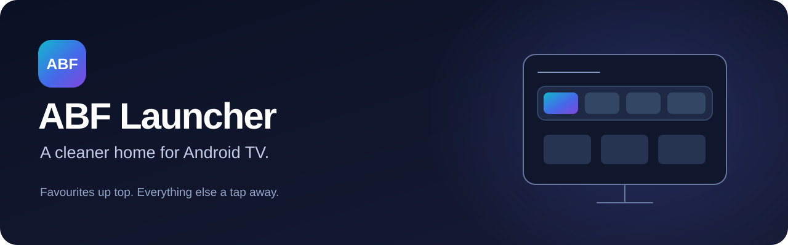
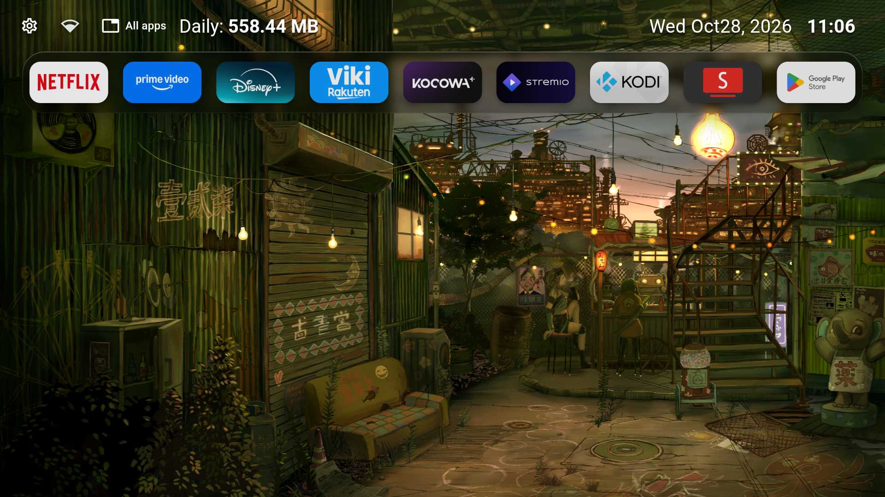
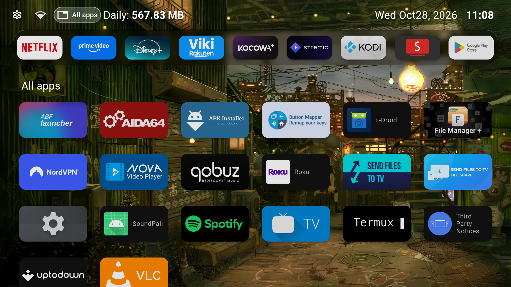

  

  <strong>Favourites up top. Everything else a tap away.</strong> 
  A clean, remote-friendly Android TV launcher based on Arc Launcher.

  
  
  

  <a href="https://github.com/emigabi/abf-luncher/releases/latest"><strong>Download APKs</strong></a> ·
  <a href="docs/INSTALLATION.md">Installation guide</a> ·
  <a href="https://github.com/emigabi/abf-luncher/issues/new/choose">Report an issue</a>

## Your TV, with less in the way

ABF Launcher keeps your favourite apps directly below the status bar. Open **All apps** beside Settings and Wi-Fi when you need the rest, then press **Back** to return to a quieter Home screen.

| Pinned Favourites | Apps on demand | Watch Next |
| --- | --- | --- |
| Adjust icon size, fill each row automatically and scroll through additional favourites. | Show the remaining apps in a separate scrolling grid while Favourites stay in place. | See the source app on each tile. Opening All apps hides Watch Next; closing it brings it back when enabled. |

Wallpaper rotation, remote navigation and the date/time controls from the Arc Launcher foundation remain available. Favourite size choices are **50%, 67%, 75% and 100%**; the default is 67%.

## See it on a real TV

These are screenshots captured from a **Box R 4K Plus running Android TV 14**, using ABF Launcher 1.0.0.

**Home — Favourites directly below the status bar**

**All apps — the remaining apps scroll below the fixed Favourites pane**

## Download

The current app release is **1.0.0**. [View the release notes, source ZIP and checksums](https://github.com/emigabi/abf-luncher/releases/tag/v1.0.0).

| APK | Use it for |
| --- | --- |
| [ARMv7 · armeabi-v7a](https://github.com/emigabi/abf-luncher/releases/download/v1.0.0/abf-launcher-1.0.0-armeabi-v7a.apk) | The Box R 4K Plus used in this project, and Android installations supporting 32-bit ARM apps |
| [ARM64 · arm64-v8a](https://github.com/emigabi/abf-luncher/releases/download/v1.0.0/abf-launcher-1.0.0-arm64-v8a.apk) | Android installations supporting 64-bit ARM apps; physical device testing is welcome |

Choose the **Android app ABI**, rather than the processor's marketing specification. The tested Box R 4K Plus has a 64-bit processor but runs 32-bit Android apps.

To get started, download the matching APK, transfer it to your TV, install it and open **ABF Launcher**. Updating an existing official ABF installation in place preserves its settings and Favourites. Changing the default Home app depends on your TV's firmware.

**[Read the installation and update guide →](docs/INSTALLATION.md)**

## Tested, with clear limits

- **46 focused tests passed**, including remote navigation through an 80-app grid, independent scrolling, icon sizes, and Watch Next returning after the drawer closes.
- **Checked on a real Box R 4K Plus:** opening and closing All apps, scrolling to the last app, Favourites staying pinned, and Watch Next returning.
- **Both APKs checked:** package name, app label, release signature, native ABI and Flutter library architecture. Published checksums match the tested files.
- **ARM64 coverage:** built and checked as an artifact; not yet tested on a physical ARM64 device.

See the [changelog](CHANGELOG.md) for the changes in this release. Date presets include `E MMMd, y`, for example `Sat Jan17, 2026`.

## Help improve ABF

Trying it on another TV? [Report a bug or suggest a feature](https://github.com/emigabi/abf-luncher/issues/new/choose) with your device model, Android version, ABF version and APK architecture. Feedback on device compatibility and D-pad navigation is especially useful.

Want to contribute code? Read [CONTRIBUTING.md](CONTRIBUTING.md) and the [build guide](docs/BUILDING.md). ABF uses Flutter 3.41.9, JDK 17 and Android SDK 36. Release builds are currently produced locally.

## Built on open source

[**Arc Launcher — original repository**](https://github.com/meddouribadis/arclauncher)

Thank you to **meddouribadis** for creating and sharing Arc Launcher, the open-source foundation of ABF Launcher.

[**CleanYourTV — original repository**](https://github.com/Gathin23/cleanyourtv)

Thank you to **Gathin23** for creating and sharing CleanYourTV, which helped guide the Android TV cleanup and launcher setup behind this project.

Arc Launcher derives from LTvLauncher and FLauncher. ABF is an independent customization based on Arc Launcher 1.2.0, commit `58fca01519b5884ad6aa3c550019d6eb60818be4`. Original credits and historical documentation are preserved in [README.upstream.md](README.upstream.md).

The package ID stays `com.omeda.arc.clean` for update compatibility. The inherited upstream self-updater is disabled in ABF release builds; get ABF updates from this repository's Releases page.

[GNU GPL-3.0-or-later](LICENSE) · Original copyright notices retained.
